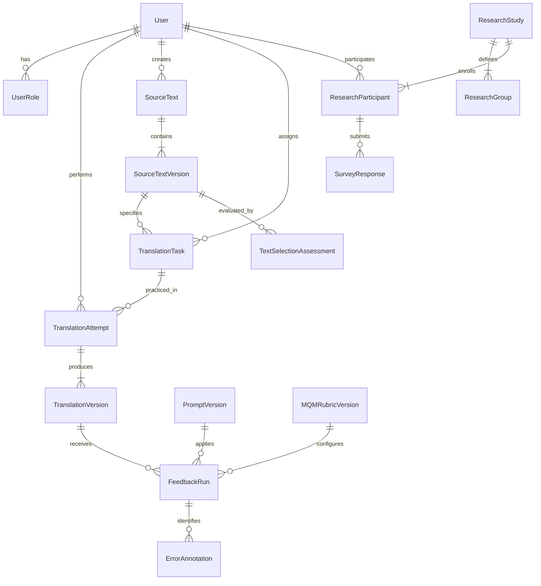

# Cấu trúc Cơ sở Dữ liệu HUFLIT TransAI

Hệ quản trị CSDL: **PostgreSQL 16**  
Công cụ ORM: **Prisma 5.22.0**

## 1. Sơ đồ Quan hệ Thực thể Chính (Core ERD)

---

## 2. Danh mục Bảng Dữ liệu (Entity Dictionary)

### 2.1. Phân hệ Định danh & Phân quyền (Identity & Access)
- `User`: Lưu thông tin tài khoản người dùng, email duy nhất, passwordHash (Bcrypt), trạng thái (`ACTIVE`, `INACTIVE`, `SUSPENDED`).
- `UserRole`: Lưu các vai trò được phân quyền cho người dùng (`STUDENT`, `TEACHER`, `RESEARCHER`, `ADMIN`). Một người dùng có thể sở hữu nhiều vai trò.
- `Session`: Phiên làm việc bảo mật.

### 2.2. Phân hệ Học liệu (Curriculum & Learning Core)
- `Genre`: Thể loại văn bản (Tổng quát, Học thuật, Kinh doanh, Du lịch, Báo chí, Kỹ thuật, Văn học).
- `CEFRLevel`: Cấp độ năng lực CEFR (B1, B2, C1).
- `SourceText`: Văn bản nguồn phục vụ dịch thuật, nguồn tham chiếu và thông tin bản quyền.
- `SourceTextVersion`: Phiên bản nội dung văn bản nguồn (bảo đảm bất biến khi đã có bài nộp tham chiếu).
- `CriteriaConfig`: Cấu hình bộ tiêu chí đánh giá học liệu (Bản dự thảo 8 tiêu chí).
- `TextSelectionAssessment`: Điểm đánh giá mức độ phù hợp của văn bản theo bộ tiêu chí.
- `TranslationTask`: Bài tập dịch thuật liên kết với một phiên bản văn bản nguồn, cấp độ CEFR, hướng dịch và chính sách Training Mode (`OFF`, `WARN`, `BLOCK_IN_EDITOR`).

### 2.3. Phân hệ Luyện dịch & Đánh giá AI (Practice & Evaluation)
- `TranslationAttempt`: Lượt làm bài của sinh viên, theo dõi trạng thái (`DRAFT`, `SUBMITTED`, `FEEDBACK_PENDING`, `FEEDBACK_READY`, `POST_EDITING`, `COMPLETED`), bộ đếm thời gian và bản nháp.
- `TranslationVersion`: Các phiên bản dịch của một lượt làm bài:
  - Bản dịch gốc: `versionNumber: 1`, `kind: ORIGINAL` (khóa bất biến).
  - Bản hậu hiệu đính: `versionNumber: 2+`, `kind: POST_EDIT`.
- `PromptVersion`: Quản lý các phiên bản Hidden Prompts cho AI, ngày kích hoạt.
- `MQMRubricVersion`: Quản lý phiên bản Rubric MQM (Taxonomy, Trọng số lỗi Minor/Major/Critical, quy tắc trừ điểm).
- `FeedbackRun`: Kết quả một lượt phân tích của AI: Điểm ước tính MQM, nhận xét tổng quát, điểm mạnh, gợi ý học tập, token usage, chi phí.
- `ErrorAnnotation`: Chi tiết từng lỗi phát hiện trong bản dịch:
  - `category`: `ACCURACY`, `FLUENCY`, `TERMINOLOGY`, `STYLE`.
  - `severity`: `MINOR` (1đ), `MAJOR` (5đ), `CRITICAL` (10đ), `NEUTRAL` (0đ).
  - `targetQuote`: Đoạn văn bản bị lỗi trong bài dịch.
  - `startOffset`, `endOffset`: Tọa độ Unicode neo vào văn bản.
  - `anchorStatus`: `ANCHORED` hoặc `UNANCHORED`.
  - `explanation`: Giải thích sư phạm vì sao xem là lỗi.
  - `suggestion`: Gợi ý cách sửa tương ứng.

### 2.4. Phân hệ Translation Memory
- `TranslationMemoryEntry`: Các cặp câu ngữ liệu song ngữ Anh-Việt đã qua thẩm định của giảng viên (`APPROVED`).

### 2.5. Phân hệ Nghiên cứu Khoa học (Research Module)
- `ResearchStudy`: Đề tài nghiên cứu, mã số nghị quyết / IRB, mô tả và phiên bản protocol.
- `ResearchParticipant`: Sinh viên tham gia đề tài, mã giảm nhận dạng (`pseudonymCode`), trạng thái đồng ý (`consentStatus`).
- `ResearchGroup`: Nhóm thực nghiệm (`AI_ASSISTED`) hoặc nhóm đối chứng (`CONTROL`).
- `ResearchGroupMembership`: Gán sinh viên vào nhóm nghiên cứu.
- `Survey`: Bảng câu hỏi khảo sát (chuẩn SUS 10 tiêu chí).
- `SurveyResponse`: Phiên trả lời của sinh viên và điểm SUS chuẩn hóa (0-100).

### 2.6. Vận hành & Giám sát (Operations & Audit)
- `AIUsageRecord`: Thống kê lượng token và chi phí phát sinh cho từng tác vụ đánh giá AI.
- `ExportJob`: Lưu vết các yêu cầu xuất dữ liệu nghiên cứu.
- `AuditLog`: Nhật ký ghi nhận các thao tác quản trị và thay đổi nhạy cảm (User, IP, User-Agent, Action).
